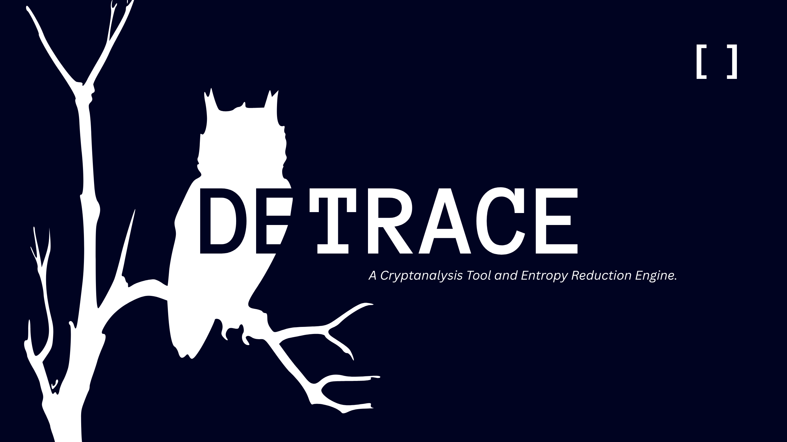

A CLI tool designed specially for cryptanalysis as an entropy reduction engine. Using a Machine Learning model, created using TensorFlow, it identifies the likelihood of each cipher algorithm, provided the cipher text. It then attempts to decrypt the text, iteratively running through the predictions. The program is also capable of decrypting ciphers with multiple layers to it.

Detrace verifies if its output is correct by checking each word against a dictionary of valid words provided. If the result is past the threshold, the program assumes it to be valid plaintext. Multiple commands are available as part of the CLI for different types of operations.

# Key Features

- **Neural Network Cipher Identification:** Uses a neural model to automatically classify ciphers.
- **Automated Decryption:** A multi-layered deciphering pipeline that strips away obfuscation, encodings, and ciphers without manual trial-and-error.
- **Multi-Source Payload:** Supports inputs from raw text strings, local files, or remote URLs via HTTP requests.
- **Structured Trace Outputs:** Creates diagnostic logs and execution traces with every transformation step through the decryption process.
- **Complete CLI architecture:** The program runs fully inside the terminal.

# Sample outputs

```bash
$ detrace decrypt --text "S1JVR1M0WkFORlpTQVlKQU9CVVdLWTNGRUJYV01JRFVNVjRIST09PQ==" --model model/main --dictionary data/dictionary.txt

Target: S1JVR1M0WkFORlpTQVlKQU9CVVdLWTNGRUJYV01JRFVNVjRIST09PQ==
================================================================================
 Layers:     2
 Status:     Success
--------------------------------------------------------------------------------
 [1] BASE64       -> KRUGS4ZANFZSAYJAOBUWKY3FEBXWMIDUMV4HI===
 [2] BASE32       -> This is a piece of text
================================================================================
 SOLUTION: This is a piece of text
================================================================================
```

```bash
$ detrace decrypt --text "P ohcl uv pklh dopjo Jhlzly thkl aopz" --model model/main --dictionary data/dictionary.txt

Target: P ohcl uv pklh dopjo Jhlzly thkl aopz
================================================================================
 Layers:     1
 Status:     Success
--------------------------------------------------------------------------------
 [1] CAESAR_CIPHER -> I have no idea which Caeser made this
================================================================================
 SOLUTION: I have no idea which Caeser made this
================================================================================
```

```bash
$ detrace identify --text "KRUGS4ZANFZSAYJAMJQXGZJTGIQHIZLTOQ======" --model model/main --top 3

--- RANK 1 ---------------------------------------------------------------------
Rank: 1
Name: base32
Confidence: 26.72%
--- RANK 2 ---------------------------------------------------------------------
Rank: 2
Name: base64
Confidence: 26.45%
--- RANK 3 ---------------------------------------------------------------------
Rank: 3
Name: url_encode
Confidence: 23.64%
--------------------------------------------------------------------------------
```

# Syntax

*This section may not include all available syntax. Please use the `-h` or any help flag supported by Python's `argparse` to learn more. Every flag and command have their own internal documentation.*

You can train your own local model with a dictionary of valid, recognized words. The 'size' parameter is the total number of inputs provided, and 'epochs' is the number of times TensorFlow passes through the training dataset. The actual data is created by creating random sentences of multiple words using the dictionary, then randomly ciphered with the list of recognized ciphers.

```bash
$ detrace train --dictionary data/dictionary.txt --size 10000 --epochs 10 --model model/main
```

For any purpose, if you wish to simply identify what cipher the given text is likely to be, you can request the Neural Network to guess for you. If the 'top' argument is any value below 1, it outputs the whole list.

```bash
$ detrace identify --text "your_ciphertext" --top 3
```

If you already know what cipher was used, you can directly decipher and validate against the dictionary.

```bash
$ detrace direct-decrypt --text "your_ciphertext" --cipher "cipher_name" --dictionary data/dictionary.txt
```

You can also automatically solve a cipher using the ML model, with very fancy, clean outputs at the end.

```bash
$ detrace decrypt --text "your_ciphertext" --dictionary data/dictionary.txt --model model/main
```

# Testing

[Pytest](https://docs.pytest.org/en/stable/) is used to test multiple CLI commands and verify if the actual output matches with the expected output. This ensures that the program functions with every change, and is run before any commit.

Asides Pytest, linting is done my [Pylint](https://www.pylint.org/) to catch subtle readability problems as well as missing or unused entities.

---

*This project is licensed under the Apache 2.0 license. See [LICENSE](LICENSE) for more information.*
